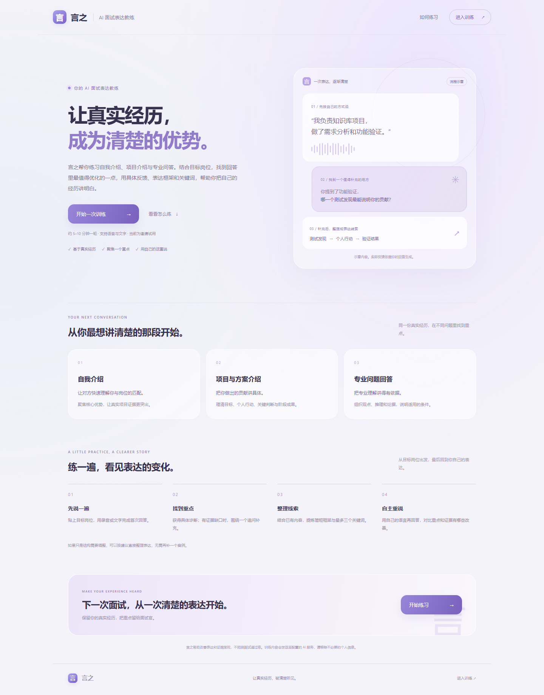
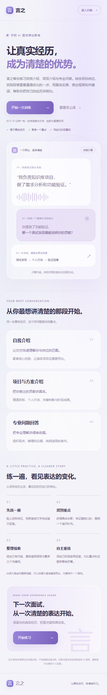
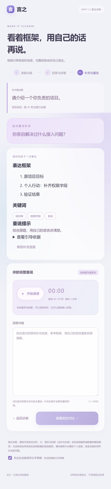
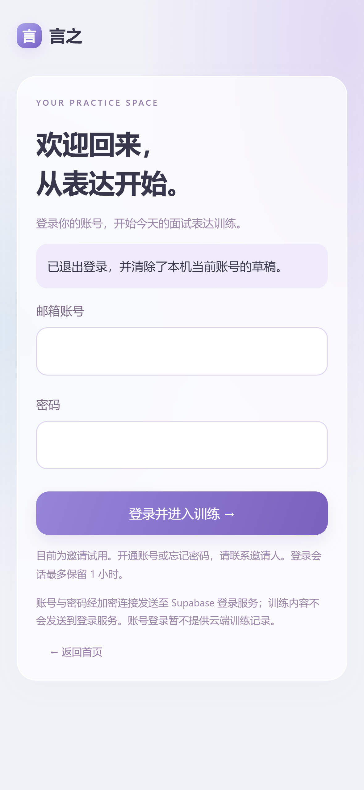
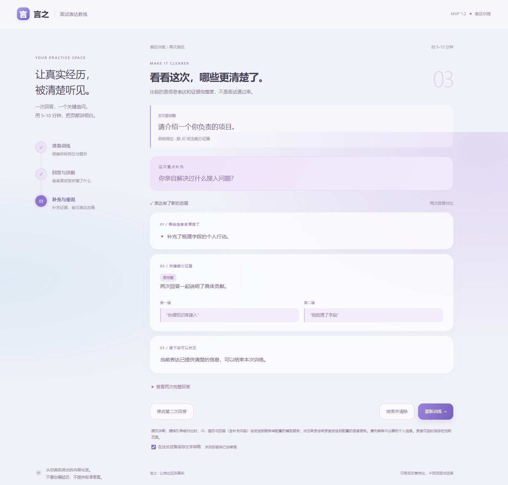

# 言之 · AI 面试表达教练

**让真实经历，成为清楚的优势。**

言之是一款帮助求职者练习面试表达的 AI 应用。它结合目标岗位 JD，识别回答中最影响面试官理解的一个问题，通过针对性追问、表达框架和关键词，引导用户用自己的语言重新回答，再比较前后表达的变化。

[在线体验](https://yanzhi-interview-coach.onrender.com/) · [页面与使用说明](docs/product-guide.md) · [部署说明](docs/deploy-render.md) · [评测与验收说明](docs/acceptance.md)

> 当前为 MVP 邀请试用。Render 免费实例空闲后可能需要等待唤醒；网站托管免费不代表 AI、语音服务免费。仓库代码与线上部署可能存在版本差异，账号登录是否启用以线上页面和 `/api/health` 为准。

2026-11-23 检查：线上首页和原训练服务可访问；独立账号登录代码已在本仓库，线上切换与真实账号登录验收尚未完成。



## 为什么做这个产品

很多面试回答已经包含真实经历，却没有突出与岗位相关的贡献、判断和成果。只给一份标准答案，不能帮助用户把自己的经历讲清楚。

言之把练习拆成一次可完成的小循环：先听懂用户已经表达了什么，再找一个值得优化的点。已有证据时优先调整重点和结构；缺少证据时才针对已有信息追问，不要求编造数据或重复已经讲清楚的内容。

## 支持哪些练习

| 训练类型 | 主要关注 |
| --- | --- |
| 自我介绍 | JD 匹配度、核心优势、真实证据、个人贡献、成果与表达效率 |
| 项目与方案介绍 | 背景与目标、个人贡献、关键决策及依据、解决过程和阶段成果 |
| 专业问题回答 | 是否回应题目、观点、专业理解、推理逻辑、论据和适用边界 |

## 一轮训练怎么进行

1. **准备岗位与题目**：粘贴 JD，选择训练类型；简历背景选填。
2. **先回答一遍**：直接输入，或录音后转为可编辑文字。
3. **查看 AI 诊断**：看到本题能力焦点、已表达的信息和一个核心问题。
4. **补充真实信息**：围绕一个具体追问补充行动、判断依据或已有验证结果。
5. **整理表达线索**：AI 提炼简短框架、最多三个关键词及一句重说提示。
6. **自主重说与对比**：用自己的语言完整重答，再查看哪些信息更清楚。

如果证据已足够、只是结构需要调整，可以按建议直接进入表达引导；如果回答已经清楚，也允许结束或自愿重练。不是每轮都必须补充案例。

### 页面预览

下列训练截图使用**合成演示输入与 Mock 响应**，用于展示交互，不代表真实模型效果或准确率。登录截图来自本地账号模式，不代表线上登录部署已完成。

| 手机首页 | 框架与关键词 | 账号登录 |
| :---: | :---: | :---: |
|  |  |  |

<details>
<summary>查看前后对比页面</summary>



</details>

## 产品与工程特点

- **一次聚焦一个问题**：反馈引用原话，解释缺口为何影响当前题目的理解。
- **按题目调整诊断重点**：自我介绍不要求展开全部技术细节，专业问题不强制套用项目故事。
- **保留事实与阶段边界**：区分已完成、进行中、计划中和状态不明；内部测试不等于真实用户价值已验证。
- **不提供完整范文**：通过简短框架和关键词帮助组织真实信息，不代替用户表达。
- **服务端校验结构与引文**：JSON Schema、连续原文引用、单问题追问和关键词数量均有代码检查。
- **访问与用量控制**：支持共享试用口令或 Supabase 邮箱密码账号；模型与语音凭证只在服务端。
- **支持本机草稿**：用户主动勾选后保存文字；账号模式按账号隔离，退出删除该账号的本机草稿。

## 技术实现

| 部分 | 技术 / 职责 |
| --- | --- |
| 前端 | React、TypeScript、Vite；响应式页面、录音、可编辑文字和训练状态 |
| 后端 | Node.js、Express；鉴权、限流、模型与语音服务代理 |
| 输出约束 | AJV + JSON Schema；字段、引用来源与单问题校验 |
| AI 接口 | 可配置的 OpenAI 兼容 Chat Completions 服务 |
| 语音转录 | 可配置的 `audio/transcriptions` 服务 |
| 账号登录 | Supabase Auth；服务端验证、短时 HttpOnly Cookie |
| 测试 | Node Test Runner、Playwright、Golden Dataset 与 Mock 场景 |
| 部署 | 一个 Render Free Node Web Service 同时提供前端与 API |

```text
浏览器（首页 / 训练 / 登录）
          ↓ 同源请求
Express（访问控制 → 用量限制 → 输入与输出校验）
          ├─ Supabase Auth：账号验证
          ├─ 模型服务：诊断 / Guidance / 前后对比
          └─ 语音服务：录音转文字
```

## 本地运行

建议使用 Node.js 24；依赖要求最低 Node.js 22.12。准备 Git 与 npm/npx，在希望存放项目的磁盘执行：

```powershell
git clone https://github.com/huahuayugouzi-commits/yanzhi-interview-coach.git
cd yanzhi-interview-coach
npx --yes pnpm@11.25.0 install --frozen-lockfile
Copy-Item .env.example .env
```

在 `.env` 中填写自己的服务配置，示例只展示字段，**不能使用示例文字作为真实密钥**：

```env
LLM_API_KEY=
LLM_BASE_URL=https://api.deepseek.com
LLM_MODEL=deepseek-chat
ASR_API_KEY=
ASR_BASE_URL=https://api.siliconflow.cn/v1
ASR_MODEL=FunAudioLLM/SenseVoiceSmall
AUTH_MODE=code
ACCESS_CODE=
```

- LLM 未配置时，后端返回明确错误，不生成虚假的成功诊断。
- ASR 未配置时仍可文字输入和录音回听，不能自动转录。
- 本地开发可使用 `AUTH_MODE=code`；公网生产必须设置足够强的口令，或配置 Supabase 账号模式。
- 账号模式还需 `AUTH_MODE=supabase`、`SUPABASE_URL`、`SUPABASE_PUBLISHABLE_KEY`。不需要数据库管理密码，不使用 service_role/secret key。[账号配置步骤](docs/deploy-render.md#独立账号登录supabase-free--现有-render-free)
- `.env`、真实用户材料和本机草稿不通过 GitHub 同步；换电脑需要分别配置。

启动开发环境：

```powershell
npx --yes pnpm@11.25.0 run dev
```

前端：http://127.0.0.1:5173 ，后端默认端口 3001。修改端口时同步检查 Vite 的 API 代理。

生产构建与本地启动：

```powershell
npx --yes pnpm@11.25.0 run build
npx --yes pnpm@11.25.0 start
```

打开 http://127.0.0.1:3001 。Windows 也可使用仓库中的 `start.cmd`。不要同时启动多个占用相同端口的实例。

## 测试与效果边界

```powershell
npx --yes pnpm@11.25.0 test
npx --yes pnpm@11.25.0 run build
npx --yes pnpm@11.25.0 run test:e2e
```

浏览器测试使用本机 Edge，启动独立测试服务，不读取真实模型密钥。模型成功路径与语音结果使用 Mock，不能据此认定真实诊断质量。Golden Dataset 包含人工编写的回归预期，也不等于模型已经通过语义验收。

**2026-11-23 文档整理时：仓库内已跟踪的 69 项 Node 测试通过；用于截图的桌面/手机训练循环与账号登录场景使用本地模拟服务。** 私人自我介绍回归材料未公开，相关本地测试不计入此处数量。

真实模型测试命令 `npx --yes pnpm@11.25.0 run test:live` **会产生模型调用费用，并覆盖对应评测结果**。只有自行确认费用后才运行。历史评测报告保留当时的模型、输入和审核边界，不代表当前所有 Prompt 已完成真实模型复验，也不宣称准确率提升。

## 数据与访问边界

- 本站服务不持久保存简历、回答或录音；账号身份由 Supabase Auth 管理，暂不提供云端训练历史。
- 点击诊断、Guidance 或对比，会将相关 JD、简历与回答发送至配置的模型服务；点击转录会发送录音至配置的语音服务。
- 录音只在当前页面临时保留；文字草稿需主动开启，保存在当前设备浏览器。请移除不必要的个人信息。
- 账号模式 Cookie 最长 1 小时，到期重新登录；不保存 refresh token。退出后的 token 边界见部署文档。
- 每小时 / 每日限流计数保存在实例内存，重启会重置，不是第三方服务的账单硬上限。
- 产品帮助改善表达，不预测录用结果，不验证用户经历真伪，不替代专业招聘判断。

## 项目目录与文档

```text
src/            首页、登录与训练界面
server/         鉴权、Prompt、模型/语音代理与输出校验
schemas/        API 输入输出结构
scripts/        开发、构建与评测脚本
tests/          合成案例、接口、安全与浏览器测试
docs/images/    README 页面截图
docs/           产品、部署、评测与参考说明
```

- [页面与使用说明](docs/product-guide.md)
- [Render 部署与账号配置](docs/deploy-render.md)
- [Guidance 流程说明](docs/guidance-flow-review.md)
- [项目阶段与诊断优化](docs/decision-depth-review.md)
- [Guidance 质量回归说明](docs/guidance-quality-review.md)
- [开源参考与第三方许可证](docs/third-party-review.md)

换电脑开发时，开始前执行 `git pull --ff-only`，修改后提交并推送；不要把 `.env`、录音或真实用户材料加入提交。项目依赖缓存使用相对目录，随工作目录所在磁盘保存。
