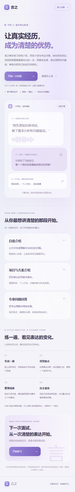
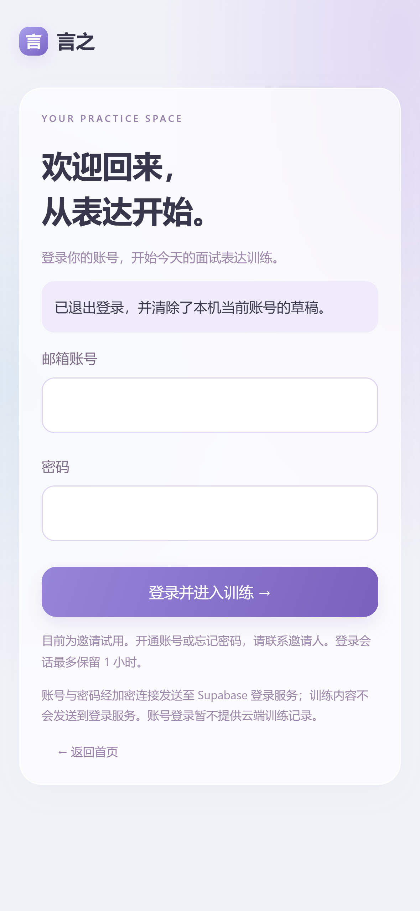
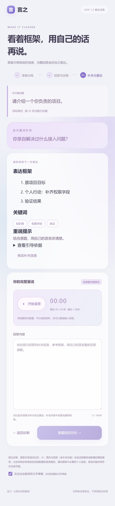
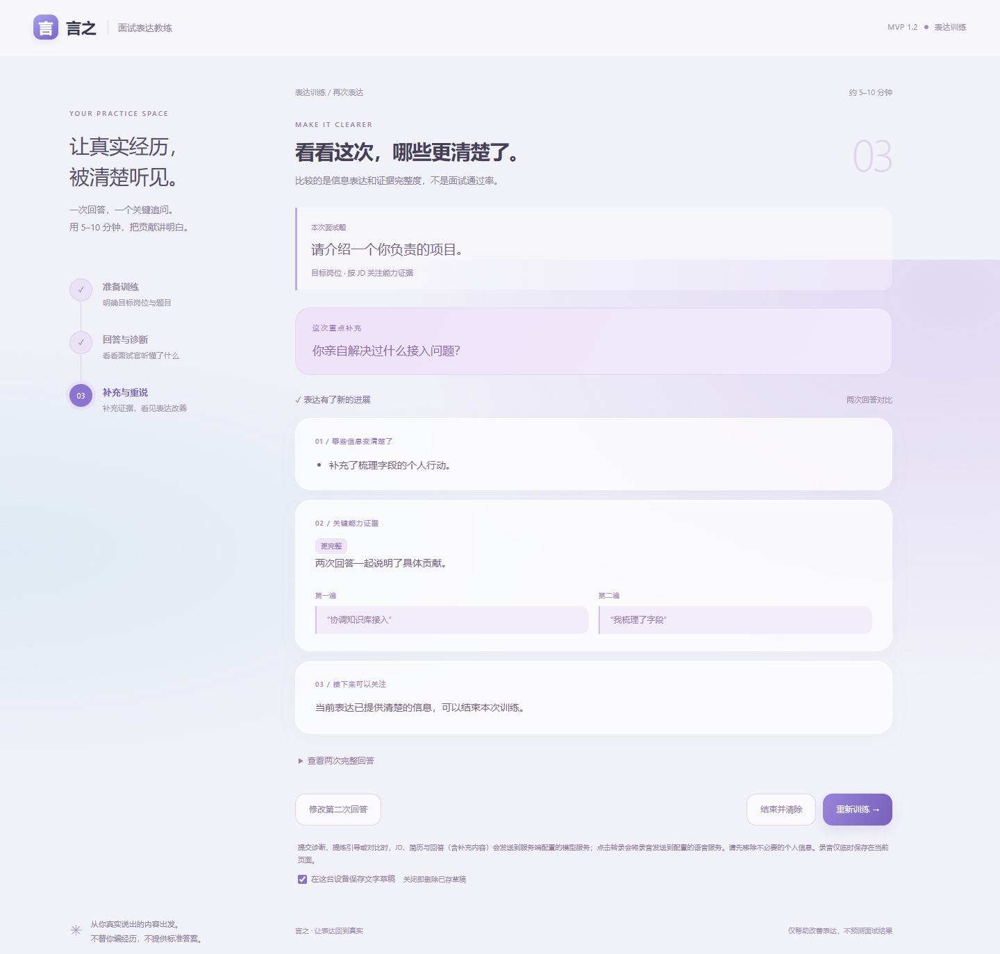

# 言之：页面与使用说明

言之帮助用户把已有经历表达得更清楚。一轮通常围绕一个最重要的问题展开，不要求覆盖全部能力，也不提供可以直接背诵的完整范文。

## 1. 首页：了解产品并进入训练

首页展示言之标识、产品用途、三类训练和练习步骤。点击「开始一次训练」进入 `/train`。

## 2. 访问训练空间

根据部署配置，训练入口采用共享试用口令，或邮箱账号与密码。账号由邀请人开通；本轮代码不提供公众注册和自助重置密码页面。

账号登录截图来自本地模拟环境。它说明仓库已经包含该功能，不代表演示网站已完成同一版本部署。

## 3. 准备目标岗位与题目

岗位 JD 为必填项，岗位名称和简历背景为选填项。用户选择自我介绍、项目与方案介绍或专业问题回答。系统依据原始题意选择诊断重点，不把所有训练都套进 STAR。

专业问题训练时，需要在回答中说明自己正在回答的具体专业问题。题意不明时，教练应先澄清题目，而不是自行猜题。

## 4. 首次回答与诊断

可以直接输入文字，也可以录音后点击转录，再修改文字。AI 反馈包括本题能力焦点、已表达的信息和一个核心问题；必要时给出一个具体追问。

判断基于用户真正说出的内容：已提到但未展开，不等于完全没有；计划中工作不等于已经取得成果。相关能力证据足够时，允许直接给结构建议，或判断当前回答已经清楚。

## 5. 补充信息后提炼框架

有追问时先补充真实信息，再生成表达引导。引导包括简短框架、最多三个关键词、重说提示，以及对应原文依据。框架应贴合具体事实；原回答清楚时优先局部补强，不默认全文重写。

只有表达结构需要调整时，可以跳过额外补充，按建议进入引导。回答已充分时，也可以自愿再练。

> 此图由合成知识库接入案例和 Mock 响应生成，展示交互流程，不代表真实模型诊断效果。

## 6. 自主重说与前后对比

用户参考框架，用自己的语言完整重答原题。系统比较首次回答与最终重说，说明哪些信息变清楚、关键证据有何变化，以及原问题是否仍需补充。补充追问的内容不冒充最终重说。

## 7. 保存与结束

- 默认文字只在当前页面。勾选「在这台设备保存文字草稿」后才写入浏览器本地存储；不是云端历史记录。
- 账号模式按账号 ID 保存草稿，退出删除当前账号本机草稿；共享设备使用完应退出。
- 点击「结束并清除」可清除当前练习与草稿。录音不作为持久文件上传保存到本站。
- 提交诊断与转录会分别调用配置的第三方模型、语音服务，请先删除不必要的个人信息。

## 截图来源

| 图片 | 来源与边界 |
| --- | --- |
| `home-desktop.png`、`home-mobile.png` | 产品首页截图，无真实求职者内容 |
| `guidance-mobile.png`、`comparison-desktop.png` | 本地浏览器训练循环，使用 `tests/e2e.spec.ts` 的合成案例与 Mock 响应 |
| `login-mobile.png` | 本地账号模式退出后的空白登录表单，无真实账号资料 |

README 的图片均保存在本仓库，不依赖私人附件地址。真实模型效果需要独立验收；截图和界面测试不用于证明准确率。
